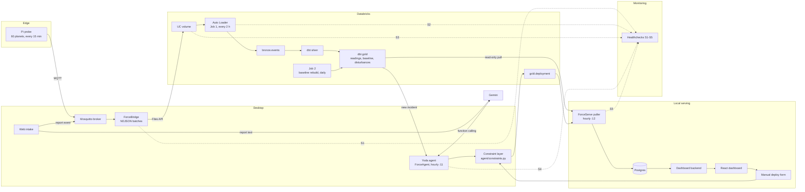

# Force Balance Pipeline

[](https://github.com/jivejong/Force_Balance_Pipeline/actions/workflows/ci.yml)
[](https://github.com/jivejong/Force_Balance_Pipeline/actions/workflows/docs.yml)
[](LICENSE)

A Star Wars-themed streaming ETL portfolio project. A Raspberry Pi probe simulates Force telemetry for 60 planets and publishes it over MQTT to a desktop bridge. The bridge lands it in Databricks Unity Catalog, where Auto Loader and dbt medallion layers (bronze, silver, gold) detect and classify disturbances. An LLM agent decides what to do about each incident, but only behind a code-enforced constraint layer. A local React dashboard shows the state and offers a manual deploy path through the same constraints.

The core claim: data survives edge, broker, bridge and cloud outages with no gaps and no loss.

All telemetry is simulated. Reference data comes from [SWAPI](https://swapi.info), extended by a governed AI enrichment layer that was generated once, human-reviewed and frozen (it is never called at runtime; [doc 08](docs/08-ai-enrichment.md)).

## See it run

A walkthrough of the dashboard on a live incident, and the dbt docs site with the model lineage:

<!-- DEMO VIDEO: Jong adds the MP4 link here -->

dbt docs: https://jivejong.github.io/Force_Balance_Pipeline/

## Architecture



How it flows:

- The probe sweeps all 60 planets every 15 minutes and publishes each sweep as one burst. If the link is down it buffers to SQLite and replays when the link returns.
- The bridge writes one NDJSON file per completed scan (or on a 4 MB / 90 second fallback) to a Unity Catalog volume through the Files API.
- Job 1 runs every 2 hours (at :03 on even UTC hours): Auto Loader ingests with `trigger(availableNow=True)`, then dbt builds silver and gold and runs the tests. Job 2 rebuilds the per-planet 90-day baseline daily at 03:40 UTC, from probe data only.
- Detection and classification are deterministic SQL. A model never sits in the per-event path; the agent sees only an incident that already has a signature.
- Web reports go through a model that infers sensor-equivalent values. They can raise an incident but never enter a baseline.
- The agent is a Windows scheduled task on the desktop. The dashboard reads only the local Postgres copy, which the ForceServe puller refreshes with read-only queries.
- Five external dead-man's-switch checks (S1 to S5) watch the bridge, Job 1, data landing, the agent and the puller, so an alert shares no failure domain with the desktop or with Databricks.

## What it demonstrates

### Outage survival

The probe's SQLite store is write-ahead and deletion waits for the broker's acknowledgement, so a crash between a sweep and its publish loses nothing. The bridge acknowledges an MQTT message only after its batch has landed.

- **Edge to broker, Phase 3 checkpoint (2026-09-29).** The link was cut on the Pi itself for 42 minutes 52 seconds. `bronze.events` held the 180 buffered rows spanning the outage, their arrival clustered within 2 seconds of the replay, proven three independent ways (workspace SQL, the Pi's journal, the bridge's landing log), with no gaps and no duplicates. Query: [`ingest/phase3_checkpoint.sql`](ingest/phase3_checkpoint.sql).
- **Scheduled outages.** The probe forces itself offline for 1 to 3 hours about twice a day. In the Phase 4 checks, a scheduled window with a backlog of 300 landed 300 rows over 5 scans with 0 duplicates ([`ingest/phase4_checkpoint.sql`](ingest/phase4_checkpoint.sql), p4-8).
- **Bridge and broker.** A roughly 22-hour bridge outage (2026-10-09/10) delivered intact on a manual restart. In a deliberate bridge outage of about 41 minutes the broker held three scans for the offline persistent session and delivered them when the bridge reconnected, with nothing buffered on the Pi.
- **Re-proof, 2026-10-14.** The desktop rebooted and nothing restarted the broker, so scans stopped landing for about eleven hours. After recovery, each of the 45 fifteen-minute slots from 06:30Z to 17:30Z held exactly 60 probe events: 2,700 events and 2,700 distinct ids, 42 of the slots (2,520 events) arrived replayed, and `silver_rejects` gained 0 rows.
- **Cloud side, 2026-11-03 to 11-17.** Databricks Free Edition stopped Job 1 for hours to days at a time when its quota ran out (see below), and once for 13 days: the workspace stopped scheduling Job 1 from 2026-11-03 16:03Z to 2026-11-17 02:03Z after a period without a login. The bridge kept landing files, and when Job 1 resumed, every UTC day from 2026-11-02 to 2026-11-16 held 96 scans and 5,760 events, with 0 duplicate event ids and no interval between scans over 15.0 minutes. Ingest lag reached 321.81 hours (314.06 hours for the oldest day ingested entirely after the stop) and every event landed. Query: [`ingest/phase8_outage_check.sql`](ingest/phase8_outage_check.sql). The catch-up also exposed a row-cap limit in the local puller, fixed with per-table paging ([doc 05, Serving (Phase 7)](docs/05-platform-setup.md#serving-phase-7)).

The monitoring itself was proven too: S1 went down at exactly the period plus grace (30 minutes) in a real outage and back up on its first ping. One finding: the checks fired but the alert email had never been verified, so nothing was delivered; that was found and fixed on 2026-10-14.

### An agent behind hard constraints

Gemini (`gemini-3.1-flash-lite`) uses function calling to propose; code decides. The agent receives an already-classified incident and has five tools (context, available Jedi, available ships, deploy, stand down). No temperature is sent.

| Rule                   | Value                                                                             |
| ---------------------- | --------------------------------------------------------------------------------- |
| Severity floor         | below 4.40 forces a stand-down                                                    |
| Master severity        | above 12.0 needs at least one Jedi of rank master, council member or grand master |
| Concurrent deployments | at most 3 galaxy-wide                                                             |
| Party size             | at most 4 Jedi per deployment                                                     |
| Mission length         | 24 hours added to the travel time to give the release time                        |

A deployment must also name no Jedi twice, use Jedi and a ship with no open deployment, match the signature's specialty, and fit the ship's capacity. An illegal proposal is rejected with every reason that applies, not just the first (one live manual deploy was rejected with five). A rejected manual deployment writes nothing.

Humans get the first look: the agent decides an incident only in a cycle after the one that first saw it, and only when it was first seen at least 30 minutes before, which with Job 1 every 2 hours is about a 2-hour window. Manual deployments from the dashboard run the identical constraint code; `decided_by` (`agent` or `user`) is the only difference in the record. The agent's evaluation is 24 fixtures run 3 times each, asserting on decision class and constraint compliance ([doc 06](docs/06-yoda-agent.md)).

### Operating inside Free Edition limits

Free Edition runs serverless compute only, with one 2X-Small SQL warehouse, so the design fits the quota instead of fighting it.

- **Job 1 cadence.** It was 15 minutes, then 30, then 60, and is now every 2 hours. At 30 minutes it exhausted the daily quota on each of 3 measured days.
- **Warm window.** The agent runs at :11 and the ForceServe puller at :12, inside Job 1's already-running warehouse window.
- **Poll gate.** The agent and the puller ask the Jobs API first (no warehouse time) and poll only after a new successful Job 1 run; otherwise the cycle costs 0 statements.
- **Quota blocks.** Between 2026-10-16 and 2026-10-27 there were 5 stretches without a Job 1 run, the longest 48.9 hours (one of the five is probably not a quota block). None have been recorded since the quota lifted on 2026-10-27, and the cause of the blocks was never established.
- **Inactivity.** From 2026-11-03 to 2026-11-16 Job 1 created no scheduled runs until a workspace login restored them, so the project logs in at least weekly.

| Measured cost                                    | Value                              |
| ------------------------------------------------ | ---------------------------------- |
| First live pull (7-day backfill, dimensions due) | 31 statements, 58.4 s, 83,024 rows |
| A steady publish                                 | 7 statements, about 10 s           |
| An idle agent cycle / a gated cycle              | 2 statements / 0 statements        |
| A rejected manual deploy                         | 3 statements, all reads            |

### Testing discipline

| Suite                         | Tests                                                   |
| ----------------------------- | ------------------------------------------------------- |
| agent                         | 573                                                     |
| edge                          | 553 (1 skipped)                                         |
| ingest                        | 388                                                     |
| intake                        | 384                                                     |
| serving                       | 190                                                     |
| scripts                       | 10                                                      |
| intake page (node)            | 205                                                     |
| dashboard (node)              | 47                                                      |
| Pester (desktop task scripts) | 72                                                      |
| dbt                           | 12 models, 5 seeds, 121 tests, 81 unit tests, 2 sources |

Every new test was mutation-checked: the production code is broken on a copy outside the repository and the test must fail on an assertion, because an error does not count as a catch. CI runs in six jobs (`python`, `serving` against a throwaway Postgres, `node`, `dbt`, `demo`, and `pester` on Windows), with no secrets and no warehouse, Gemini, broker or Pi. A manifest check after `dbt parse` fails if the dbt project no longer has exactly the expected resource counts above ([`scripts/check_dbt_manifest.py`](scripts/check_dbt_manifest.py)).

## Quickstart (no cloud account needed)

Prerequisites: Docker, Python 3.10 or later, Node 24 and make.

```bash
git clone https://github.com/jivejong/Force_Balance_Pipeline.git
cd Force_Balance_Pipeline
make demo
```

`make demo` starts its own Postgres container and loads the display fixtures into it, builds the dashboard and serves it on http://127.0.0.1:8082/ (Postgres is on 127.0.0.1:5434). Deploy is off in the demo. It uses no live credential and makes no call to Databricks, Gemini or a broker.

- `make demo-down` stops the database and keeps its data; `make demo-clean` removes the container, volume and local files.
- `make test` runs the Python and node suites. It expects the project venvs (`edge/.venv`, `serving/.venv`), and the serving suite needs a local Postgres on 127.0.0.1:5433 and a `.env.serving`. `make test-dashboard` builds and tests the dashboard and `make check-dbt` runs the dbt manifest check. CI overrides the interpreters; see [doc 05](docs/05-platform-setup.md), "CI (GitHub Actions)".

Running the full pipeline needs a Databricks Free Edition workspace, a Raspberry Pi and an MQTT broker; see [doc 05](docs/05-platform-setup.md).

## Repository map

| Folder       | Contents                                                                                                     |
| ------------ | ------------------------------------------------------------------------------------------------------------ |
| `agent/`     | The Yoda agent: constraint layer, Gemini loop, Statement API client, evaluation fixtures                     |
| `dashboard/` | The React and Vite dashboard and its node tests                                                              |
| `data/`      | The SWAPI snapshot and the enrichment corrections                                                            |
| `docs/`      | The design docs 00-08, the engineering log and the phase results                                             |
| `edge/`      | The probe simulator (`forcesim`, `probe_sim.py`) and the 90-day backfill generator                           |
| `infra/`     | Docker Compose files, Mosquitto config, Raspberry Pi service files and the Windows task registration scripts |
| `ingest/`    | The collector bridge, Auto Loader notebook, and the per-phase checkpoint SQL                                 |
| `intake/`    | The web intake: server, model core, page and fixtures                                                        |
| `resources/` | The Databricks job definitions (Job 1 and Job 2)                                                             |
| `scripts/`   | The demo launcher, the dbt manifest check and the enrichment and seed builders                               |
| `serving/`   | The puller, the local Postgres schema and views, and the dashboard backend                                   |
| `warehouse/` | The dbt project (`warehouse/dbt`)                                                                            |

## Documentation

| Doc                                        | Title                                                              |
| ------------------------------------------ | ------------------------------------------------------------------ |
| [00](docs/00-session-handoff.md)           | Session handoff                                                    |
| [01](docs/01-architecture.md)              | Architecture                                                       |
| [02](docs/02-event-contract.md)            | Event contract                                                     |
| [03](docs/03-data-model.md)                | Data model                                                         |
| [04](docs/04-edge-simulators.md)           | Edge simulator and web intake                                      |
| [05](docs/05-platform-setup.md)            | Platform setup                                                     |
| [06](docs/06-yoda-agent.md)                | Yoda agent and deployment decisions                                |
| [07](docs/07-implementation-plan.md)       | Implementation plan                                                |
| [08](docs/08-ai-enrichment.md)             | AI enrichment layer                                                |
| [Engineering log](docs/ENGINEERING-LOG.md) | What happened, in order, including what broke and how it was found |

## How this repository is developed

This repository is a one-way mirror of the `Force_Balance_Pipeline` folder of [jivejong/JiveRepo](https://github.com/jivejong/JiveRepo), where development happens. Commit SHAs cited in the docs refer to JiveRepo. Issues are disabled here.

## License

MIT, see [LICENSE](LICENSE).

Star Wars reference data courtesy of [swapi.info](https://swapi.info), a community-maintained mirror of the original SWAPI project by Paul Hallett. Star Wars is a trademark of Lucasfilm Ltd. This is an unaffiliated, non-commercial portfolio exercise.
